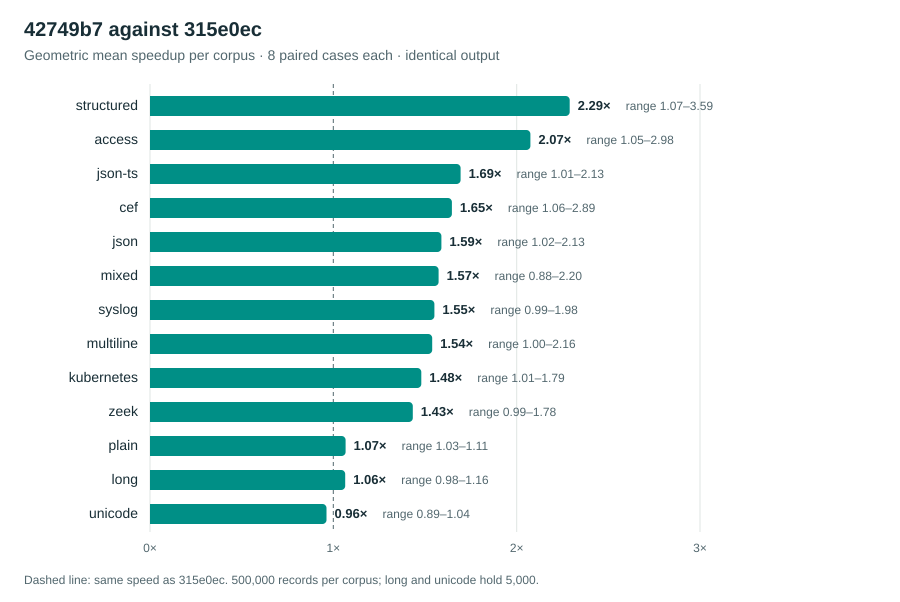
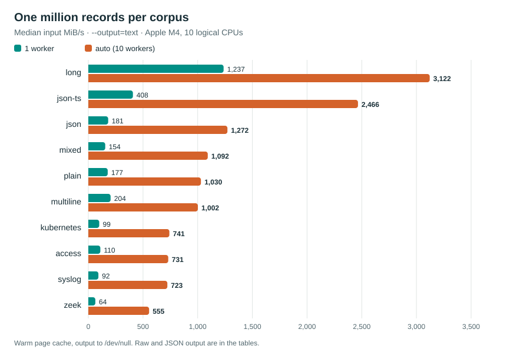

<!--
SPDX-FileCopyrightText: 2026 lumtail contributors
SPDX-License-Identifier: MIT
-->

# Revision 42749b7 benchmarks

Read this page if you size a Lumtail run and want measured throughput, memory and latency for commit `42749b7`, and its speed against the older commit `315e0ec`.

## Summary

- **1.49× faster than `315e0ec`** across 104 paired cases (geometric mean), up to 3.59×, with byte-identical output in every case.
- **1 GiB of AWS CloudTrail JSON filtered in 0.61 s** (1,675 MiB/s) with 21.5 MiB peak RSS.
- **1,000,000 JSON records rendered as text in 0.101 s** (1,272 MiB/s, 9.9 million records/s).
- **Peak RSS stays under 36 MiB** in every measured case, including 3.9 GiB inputs.
- **Vector JSON escaping runs at 18.8 B/ns**, 18× the scalar code, on 64 KiB inputs.





## Run

- Revision: `42749b7a14dd751848f3b9b2136556bc5dc31db7` (`main`, 2026-11-12).
- Host: Apple M4, 10 logical CPUs (4 performance, 6 efficiency), 16 GiB, macOS-27.2.1-arm64-arm-64bit.
- Compiler: Apple clang 21.0.0, CMake `Release`, `-O3`, LTO on, hardening on, `LUMTAIL_NATIVE=OFF`, `LUMTAIL_SIMD=ON`.
- Python 3.9.6 drives every run; each case runs 1 warm-up and 5 measured samples unless a table says otherwise. Tables report medians.
- Raw samples, commands and input hashes: the JSON files next to this page.
- The [benchmark procedure](../../README.md) explains the measurement method.

SHA-256 of the measured executables:

```text
6876b905a16cc1d879aba354840ef30665fbcb98cc589e30833f54b2914c38cd  lumtail  (42749b7)
a765877171bb8142047a915342d61a1c83519b3173aa11c368bc4fc549e12152  lumtail_allocations  (42749b7)
d9c0016afddb1dd75cba66d6886520c9d2b46632ef542c6fd5260e499555aabc  lumtail_benchmarks  (42749b7)
fdffa791059151cb1d799ac888ccda5210272e555a5478a5097426cb256fd251  lumtail_simd_benchmarks  (42749b7)
d236fdf7d81dee745f737406c91770a5a8105d7ea06d184e9963dd8e6c9e8882  lumtail  (315e0ec)
fdffa791059151cb1d799ac888ccda5210272e555a5478a5097426cb256fd251  lumtail_simd_benchmarks  (315e0ec)
```

Commands, from the repository root, with the binaries copied to `$O`:

```sh
python3 benchmarks/suite.py $O/lumtail --core $O/lumtail_benchmarks \
  --allocations $O/lumtail_allocations --latency-source pipe follow \
  --latency-records 1000 --timeout 600 --output suite.json
python3 benchmarks/suite.py $O/lumtail --suite pipeline --lines 1000000 \
  --threads 1 4 auto --repetitions 5 --timeout 900 --output stress-1m.json
$O/lumtail_simd_benchmarks 2000 > simd.json
python3 benchmarks/public_logs.py $O/lumtail --output public-logs.json
python3 benchmarks/compare.py $O/baseline-315e0ec/lumtail $O/lumtail --lines 500000 \
  --repetitions 5 --threads 1 4 --mode text json raw agent --corpus <corpus> \
  --output compare-315e0ec-<corpus>.json
```

## Public logs

Two public corpora of 1 and 1.25 GiB, filtered with fixed queries and rendered as `--output=json`. The [public-log report](../../../docs/benchmarks-public-logs.md) lists every query, source and license.

| Corpus | Query | 1 worker MiB/s | auto MiB/s | auto seconds | Peak RSS MiB |
| --- | ---: | ---: | ---: | ---: | ---: |
| CloudTrail JSON, 1.0 GiB | parse + render | 131 | 1,125 | 0.91 | 30.4 |
| CloudTrail JSON, 1.0 GiB | selective filter | 234 | 1,675 | 0.61 | 21.5 |
| CloudTrail JSON, 1.0 GiB | broad filter | 119 | 1,086 | 0.94 | 30.5 |
| CloudTrail JSON, 1.0 GiB | late-miss filter | 215 | 1,522 | 0.67 | 20.7 |
| RFC 5424 syslog, 1.25 GiB | parse + render | 93 | 577 | 2.22 | 35.4 |
| RFC 5424 syslog, 1.25 GiB | selective filter | 127 | 892 | 1.44 | 18.8 |
| RFC 5424 syslog, 1.25 GiB | broad filter | 79 | 553 | 2.32 | 35.0 |
| RFC 5424 syslog, 1.25 GiB | late-miss filter | 96 | 544 | 2.35 | 18.3 |

## One million records per corpus

Generated corpora from `benchmarks/suite.py`, 1,000,000 records each, warm page cache, output to `/dev/null`. MiB/s divides the input size by the median elapsed time.

| Corpus | Input MiB | Output | 1 worker MiB/s | 4 workers MiB/s | auto MiB/s | auto seconds | Peak RSS MiB |
| --- | ---: | ---: | ---: | ---: | ---: | ---: | ---: |
| `json` | 129 | text | 181 | 759 | 1,272 | 0.101 | 16.5 |
| `json` | 129 | json | 119 | 431 | 858 | 0.150 | 24.3 |
| `json` | 129 | raw | 2,258 | 2,192 | 2,201 | 0.058 | 2.4 |
| `syslog` | 51 | text | 92 | 376 | 723 | 0.070 | 18.7 |
| `syslog` | 51 | json | 66 | 272 | 417 | 0.121 | 27.7 |
| `syslog` | 51 | raw | 1,270 | 1,182 | 1,127 | 0.045 | 2.6 |
| `access` | 70 | text | 110 | 457 | 731 | 0.096 | 18.2 |
| `access` | 70 | json | 72 | 286 | 463 | 0.151 | 26.8 |
| `access` | 70 | raw | 1,598 | 1,852 | 1,905 | 0.037 | 2.6 |
| `plain` | 58 | text | 177 | 669 | 1,030 | 0.057 | 15.0 |
| `plain` | 58 | json | 118 | 448 | 803 | 0.072 | 27.2 |
| `plain` | 58 | raw | 1,357 | 1,363 | 1,340 | 0.043 | 2.4 |
| `mixed` | 102 | text | 154 | 632 | 1,092 | 0.094 | 18.8 |
| `mixed` | 102 | json | 103 | 418 | 802 | 0.127 | 27.3 |
| `mixed` | 102 | raw | 1,994 | 2,019 | 2,058 | 0.050 | 2.4 |
| `multiline` | 181 | text | 204 | 827 | 1,002 | 0.181 | 8.6 |
| `multiline` | 181 | json | 140 | 618 | 1,018 | 0.178 | 24.4 |
| `multiline` | 181 | raw | 1,003 | 1,004 | 986 | 0.183 | 2.8 |
| `long` | 3,956 | text | 1,237 | 3,125 | 3,122 | 1.267 | 10.4 |
| `long` | 3,956 | json | 885 | 3,086 | 3,098 | 1.277 | 18.4 |
| `long` | 3,956 | raw | 2,989 | 2,917 | 2,821 | 1.402 | 2.7 |
| `zeek` | 198 | text | 64 | 252 | 555 | 0.356 | 19.1 |
| `zeek` | 198 | json | 47 | 185 | 353 | 0.561 | 28.2 |
| `zeek` | 198 | raw | 2,691 | 2,696 | 2,721 | 0.073 | 2.4 |
| `json-ts` | 1,028 | text | 408 | 1,681 | 2,466 | 0.417 | 18.4 |
| `json-ts` | 1,028 | json | 231 | 932 | 1,537 | 0.669 | 27.8 |
| `json-ts` | 1,028 | raw | 3,824 | 3,682 | 3,760 | 0.273 | 2.4 |
| `kubernetes` | 249 | text | 99 | 339 | 741 | 0.337 | 18.1 |
| `kubernetes` | 249 | json | 69 | 248 | 529 | 0.471 | 24.9 |
| `kubernetes` | 249 | raw | 3,014 | 2,875 | 2,987 | 0.084 | 2.4 |

## Against 315e0ec

`315e0ec` is 176 commits older (2026-11-08) and was built with the same compiler and flags. `benchmarks/compare.py` runs both binaries on the same file in alternating order and stops if their outputs differ by one byte; every case below produced byte-identical output. Speedup is baseline median divided by `42749b7` median; above 1.00 means `42749b7` is faster. Inputs hold 500,000 records, except `long` and `unicode`, which hold 5,000.

| Corpus | text 1 | text 4 | json 1 | json 4 | agent 1 | agent 4 | raw 1 | raw 4 |
| --- | ---: | ---: | ---: | ---: | ---: | ---: | ---: | ---: |
| `access` | 2.68 | 2.98 | 2.16 | 2.78 | 2.38 | 2.66 | 1.07 | 1.05 |
| `cef` | 1.82 | 1.79 | 1.69 | 2.89 | 1.71 | 1.71 | 1.10 | 1.06 |
| `json` | 1.76 | 2.13 | 1.77 | 1.85 | 1.58 | 1.97 | 1.05 | 1.02 |
| `plain` | 1.11 | 1.11 | 1.07 | 1.09 | 1.03 | 1.08 | 1.04 | 1.03 |
| `mixed` | 1.91 | 2.20 | 1.75 | 1.84 | 1.69 | 1.95 | 0.88 | 0.96 |
| `unicode` | 0.99 | 1.00 | 0.90 | 0.89 | 0.89 | 1.04 | 1.00 | 1.00 |
| `json-ts` | 1.94 | 2.13 | 1.97 | 2.07 | 1.89 | 2.09 | 1.01 | 1.02 |
| `kubernetes` | 1.62 | 1.79 | 1.68 | 1.78 | 1.52 | 1.71 | 1.01 | 1.01 |
| `long` | 1.12 | 1.05 | 1.09 | 1.16 | 1.09 | 0.98 | 1.03 | 1.02 |
| `multiline` | 1.63 | 2.16 | 1.63 | 1.97 | 1.44 | 1.91 | 1.01 | 1.00 |
| `structured` | 2.98 | 3.32 | 2.34 | 3.59 | 2.61 | 3.00 | 1.08 | 1.07 |
| `syslog` | 1.92 | 1.90 | 1.65 | 1.98 | 1.65 | 1.71 | 1.00 | 0.99 |
| `zeek` | 1.61 | 1.73 | 1.71 | 1.78 | 1.43 | 1.48 | 1.01 | 0.99 |

Across 104 paired cases the geometric mean speedup is 1.49; the range is 0.88 to 3.59.

The cases below 0.95 were measured again with 15 samples each:

| Corpus | Output | Workers | 315e0ec ms | 42749b7 ms | Speedup |
| --- | ---: | ---: | ---: | ---: | ---: |
| `mixed` | raw | 1 | 28.36 | 27.56 | 1.03 |
| `mixed` | raw | 4 | 27.85 | 26.64 | 1.05 |
| `mixed` | json | 1 | 876.06 | 493.19 | 1.78 |
| `mixed` | json | 4 | 244.64 | 123.86 | 1.98 |
| `mixed` | agent | 1 | 573.62 | 343.03 | 1.67 |
| `mixed` | agent | 4 | 169.08 | 85.53 | 1.98 |
| `unicode` | raw | 1 | 8.67 | 8.76 | 0.99 |
| `unicode` | raw | 4 | 8.68 | 8.72 | 1.00 |
| `unicode` | json | 1 | 26.36 | 26.98 | 0.98 |
| `unicode` | json | 4 | 10.81 | 10.27 | 1.05 |
| `unicode` | agent | 1 | 21.09 | 19.47 | 1.08 |
| `unicode` | agent | 4 | 9.22 | 8.40 | 1.10 |

## Startup and streaming response

| Measurement (1 worker) | Median |
| --- | ---: |
| `--version` | 5.4 ms |
| Format registry | 5.5 ms |
| pipe, line, first response | 5.17 ms |
| pipe, line, later responses (median / p99) | 0.012 / 0.018 ms |
| pipe, multiline, first response | 62.31 ms |
| pipe, multiline, later responses (median / p99) | 55.193 / 60.239 ms |
| follow, line, first response | 6.11 ms |
| follow, line, later responses (median / p99) | 109.024 / 110.151 ms |
| follow, multiline, first response | 113.86 ms |
| follow, multiline, later responses (median / p99) | 216.380 / 220.261 ms |

Each response is one record written to a pipe or appended to a followed file, then read back as JSON. Follow mode polls every 100 ms ([guide](../../../docs/guide.md#files-and-streams)), so that interval sets the follow response time. Multiline cases run with `--multiline=indent --multiline-timeout-ms=20`.

## Rules

| Rule modules | Load ms | Last match 1 worker Mrec/s | Last match auto Mrec/s | No match 1 worker Mrec/s | No match auto Mrec/s |
| --- | ---: | ---: | ---: | ---: | ---: |
| 1 | 6.7 | 3.06 | 9.39 | 2.60 | 8.62 |
| 16 | 6.9 | 1.68 | 6.70 | 2.51 | 8.57 |
| 64 | 7.7 | 0.78 | 3.91 | 2.31 | 8.03 |

## Saving to disk

Text output of 100,000 records written to a file, then flushed with fsync:

| Corpus | 1 worker total ms | 1 worker fsync ms | auto total ms | auto fsync ms |
| --- | ---: | ---: | ---: | ---: |
| `json` | 76.7 | 1.93 | 17.5 | 2.54 |
| `syslog` | 62.7 | 1.62 | 15.8 | 1.37 |
| `access` | 72.1 | 2.60 | 16.4 | 1.77 |
| `long` | 455.2 | 0.32 | 135.3 | 0.26 |

## Byte-scan kernels

`lumtail_simd_benchmarks` times every compiled scan backend. On this CPU Lumtail selects `NEON_BF16`. Bytes per nanosecond, 2,000 calls per case:

| Kernel | scalar 64 B | NEON_BF16 64 B | scalar 64 KiB | NEON_BF16 64 KiB |
| --- | ---: | ---: | ---: | ---: |
| `terminal/no-special` | 1.60 | 16.52 | 2.07 | 29.57 |
| `json/no-special` | 0.88 | 16.70 | 1.04 | 18.84 |
| `token/no-special` | 1.17 | 16.52 | 1.39 | 26.47 |
| `newline/no-match` | 11.29 | 8.37 | 32.78 | 29.86 |
| `literal/no-match` | 9.54 | 7.40 | 32.71 | 16.46 |
| `literal/repetitive` | 0.13 | 5.12 | 0.08 | 16.46 |

`literal/repetitive` searches for 31 `a` and a `b` inside text made only of `a`. The vector backend keeps it linear; the scalar fallback drops to 0.08 B/ns on 64 KiB. The scalar newline and literal searches call `std::string_view::find`; on 64 KiB without a match they run at 32.7 B/ns, ahead of the 16.5 B/ns of the vector literal search.

## Limits

- One machine, one run. Another CPU, a cold page cache or a slow disk changes every number.
- The 100,000-record suite runs finish in 10 to 50 ms, so process start-up weighs on its multi-worker results; use the one-million-record table for throughput.
- The paired comparison uses generated corpora; the public-log report covers real logs for `42749b7` only.
