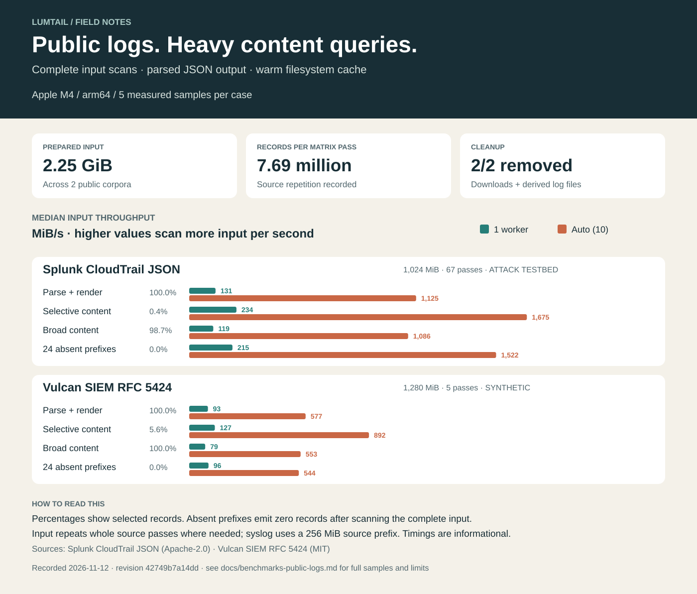

<!--
SPDX-FileCopyrightText: 2026 lumtail contributors
SPDX-License-Identifier: MIT
-->

# Public-log content benchmark

Read this report to size a Lumtail content-filtering run against the recorded public logs and machine.



## Run

- Completed: `2026-11-12T21:35:05.208975+00:00`.
- Host: Apple M4; macOS-27.2.1-arm64-arm-64bit; 10 logical CPUs.
- Revision: `42749b7a14dd751848f3b9b2136556bc5dc31db7`; executable SHA-256 `6876b905a16cc1d879aba354840ef30665fbcb98cc589e30833f54b2914c38cd`.
- Compiler: unavailable.
- Python: 3.9.6. Build settings: `{}`.
- Per case: 1 warm-up, 5 measured samples; shuffled rounds, seed `20261110`.
- Total: 32 cases, 160 measured scans, 180.0 GiB of cumulative measured input.
- [Raw samples, commands, hashes and cleanup](../benchmarks/results/42749b7/public-logs.json).

```sh
/Applications/Xcode.app/Contents/Developer/usr/bin/python3 benchmarks/public_logs.py .cache/build-artifacts/benchmarks/42749b7/lumtail --output .cache/build-artifacts/benchmarks/42749b7/public-logs.json
```

The executable was measured from the recorded working tree. The JSON records the changed files and driver hashes.
Follow the [benchmark procedure](../benchmarks/README.md#manual-public-log-workload) for measurement and cleanup details.

## Inputs

| Corpus | Prepared source MiB | Source records | Full passes | Measured MiB | Measured records | License |
| --- | ---: | ---: | ---: | ---: | ---: | --- |
| [Splunk CloudTrail JSON](https://github.com/splunk/attack_data/tree/c8af10d015d392fca97f9eb65181e9f06bc18e40/datasets/attack_techniques/T1562.007/aws_delete_acl) | 15.29 | 13,274 | 67 | 1,024.30 | 889,358 | [Apache-2.0](https://github.com/splunk/attack_data/blob/c8af10d015d392fca97f9eb65181e9f06bc18e40/LICENSE) |
| [Vulcan SIEM RFC 5424](https://huggingface.co/datasets/vulcansiem/synthetic-syslog-1B) | 256.00 | 1,360,255 | 5 | 1,280.00 | 6,801,275 | [MIT](https://huggingface.co/datasets/vulcansiem/synthetic-syslog-1B/blob/2e8204a084de2ba490f7f452b9dfbd39d074c670/README.md) |

### Source credits and preparation

- **Splunk CloudTrail JSON:** Patrick Bareiss / Splunk Inc., Attack Data, aws_delete_acl, revision c8af10d015d392fca97f9eb65181e9f06bc18e40. AWS CloudTrail telemetry captured in Splunk Attack Range for public detection testing. [Published benchmark](https://github.com/splunk/attack_data#readme). Python source-format counts: `{"json": 13274}`. 0 rows changed; 0 incomplete range bytes dropped.
- **Vulcan SIEM RFC 5424:** VulcanSIEM / sartimo, synthetic-syslog-1B, revision 2e8204a084de2ba490f7f452b9dfbd39d074c670. Synthetic SIEM benchmark; first 256 MiB, cut back to the last complete record. [Published benchmark](https://huggingface.co/datasets/vulcansiem/synthetic-syslog-1B). Python source-format counts: `{"syslog": 1360255}`. 0 rows changed; 83 incomplete range bytes dropped.

## Results

Input MiB/s divides the complete input size by median elapsed time. CPU seconds sum user and system time; RSS is the maximum observed child peak.
Elapsed min–max shows the spread across measured samples. Selected records are a percentage of all input records.

### Splunk CloudTrail JSON

| Query | Output | Workers | Selected | Input MiB/s | Elapsed median (s) | Min–max (s) | CPU median (s) | Peak RSS (MiB) |
| --- | --- | --- | ---: | ---: | ---: | ---: | ---: | ---: |
| Parse + render | json | 1 | 100.00% | 130.7 | 7.836 | 7.754–7.845 | 7.829 | 4.97 |
| Parse + render | json | auto (10) | 100.00% | 1,125.5 | 0.910 | 0.903–0.934 | 8.809 | 30.41 |
| Parse + render | agent | 1 | 100.00% | 230.6 | 4.442 | 4.400–4.511 | 4.439 | 4.20 |
| Parse + render | agent | auto (10) | 100.00% | 1,666.1 | 0.615 | 0.613–0.640 | 5.969 | 20.98 |
| Selective content | json | 1 | 0.38% | 234.4 | 4.369 | 4.294–4.413 | 4.366 | 4.50 |
| Selective content | json | auto (10) | 0.38% | 1,674.6 | 0.612 | 0.607–0.735 | 5.883 | 21.50 |
| Selective content | agent | 1 | 0.38% | 176.6 | 5.798 | 4.293–5.868 | 5.796 | 4.16 |
| Selective content | agent | auto (10) | 0.38% | 1,676.6 | 0.611 | 0.606–0.618 | 5.879 | 21.20 |
| Broad content | json | 1 | 98.75% | 119.5 | 8.572 | 8.515–8.583 | 8.565 | 4.44 |
| Broad content | json | auto (10) | 98.75% | 1,085.8 | 0.943 | 0.930–0.967 | 9.098 | 30.48 |
| Broad content | agent | 1 | 98.75% | 217.9 | 4.700 | 4.681–4.787 | 4.694 | 4.52 |
| Broad content | agent | auto (10) | 98.75% | 1,523.6 | 0.672 | 0.653–0.734 | 6.357 | 21.00 |
| 24 absent prefixes | json | 1 | 0.00% | 214.6 | 4.772 | 4.750–4.875 | 4.770 | 4.09 |
| 24 absent prefixes | json | auto (10) | 0.00% | 1,522.1 | 0.673 | 0.660–0.681 | 6.497 | 20.69 |
| 24 absent prefixes | agent | 1 | 0.00% | 214.3 | 4.781 | 4.769–4.831 | 4.778 | 4.08 |
| 24 absent prefixes | agent | auto (10) | 0.00% | 1,528.0 | 0.670 | 0.662–0.678 | 6.474 | 20.58 |

### Vulcan SIEM RFC 5424

| Query | Output | Workers | Selected | Input MiB/s | Elapsed median (s) | Min–max (s) | CPU median (s) | Peak RSS (MiB) |
| --- | --- | --- | ---: | ---: | ---: | ---: | ---: | ---: |
| Parse + render | json | 1 | 100.00% | 92.9 | 13.779 | 13.256–13.817 | 13.626 | 3.97 |
| Parse + render | json | auto (10) | 100.00% | 577.4 | 2.217 | 1.919–3.088 | 17.253 | 35.36 |
| Parse + render | agent | 1 | 100.00% | 147.1 | 8.700 | 8.538–9.808 | 8.558 | 3.81 |
| Parse + render | agent | auto (10) | 100.00% | 990.5 | 1.292 | 1.254–1.416 | 11.365 | 23.53 |
| Selective content | json | 1 | 5.62% | 127.2 | 10.064 | 9.710–10.089 | 9.888 | 3.70 |
| Selective content | json | auto (10) | 5.62% | 891.5 | 1.436 | 1.401–1.625 | 12.786 | 18.81 |
| Selective content | agent | 1 | 5.62% | 134.9 | 9.489 | 9.293–10.478 | 9.428 | 3.39 |
| Selective content | agent | auto (10) | 5.62% | 892.3 | 1.435 | 1.389–1.613 | 12.078 | 18.86 |
| Broad content | json | 1 | 100.00% | 79.5 | 16.109 | 15.880–16.541 | 15.944 | 4.03 |
| Broad content | json | auto (10) | 100.00% | 552.7 | 2.316 | 2.231–4.626 | 20.373 | 35.00 |
| Broad content | agent | 1 | 100.00% | 114.8 | 11.154 | 10.938–12.339 | 11.056 | 3.81 |
| Broad content | agent | auto (10) | 100.00% | 773.0 | 1.656 | 1.566–1.757 | 14.572 | 27.39 |
| 24 absent prefixes | json | 1 | 0.00% | 95.9 | 13.348 | 13.125–13.455 | 13.184 | 3.14 |
| 24 absent prefixes | json | auto (10) | 0.00% | 543.8 | 2.354 | 1.783–2.552 | 16.413 | 18.31 |
| 24 absent prefixes | agent | 1 | 0.00% | 96.7 | 13.234 | 13.112–13.498 | 13.099 | 3.16 |
| 24 absent prefixes | agent | auto (10) | 0.00% | 702.3 | 1.822 | 1.693–1.945 | 16.386 | 18.52 |

## Content queries

`parse` reads, parses and renders every record. `late-miss` deliberately selects zero records after evaluating 24 content prefixes.

### Splunk CloudTrail JSON

**selective:** 3,417 of 889,358 records.

```text
(eventName~"Delete*" OR eventName~"Create*" OR eventName~"Authorize*" OR eventName~"Revoke*") AND readOnly=false AND eventSource=ec2.amazonaws.com AND eventVersion>=1.05 AND eventVersion<2 AND (awsRegion=eu-central-1 OR awsRegion=us-east-2 OR awsRegion=us-west-2) AND userAgent!="" AND NOT sourceIPAddress=127.0.0.1
```

**broad:** 878,236 of 889,358 records.

```text
(eventName~"Describe*" OR eventName~"Get*" OR eventName~"List*") AND (awsRegion~"us-*" OR awsRegion~"eu-*") AND eventVersion>=1.05 AND eventVersion<2 AND readOnly=true AND (userAgent~"eks*" OR userAgent~"autoscaling*" OR userAgent~"aws-internal*" OR userAgent~"Boto3*" OR userAgent~"aws-sdk-go*" OR userAgent~"console.ec2*") AND sourceIPAddress!=""
```

**late-miss:** 0 of 889,358 records.

```text
userAgent~"aws-internal/3 aws-sdk-java/1.11.922 benchmark-absent-00*" OR userAgent~"aws-internal/3 aws-sdk-java/1.11.922 benchmark-absent-01*" OR userAgent~"aws-internal/3 aws-sdk-java/1.11.922 benchmark-absent-02*" OR userAgent~"aws-internal/3 aws-sdk-java/1.11.922 benchmark-absent-03*" OR userAgent~"aws-internal/3 aws-sdk-java/1.11.922 benchmark-absent-04*" OR userAgent~"aws-internal/3 aws-sdk-java/1.11.922 benchmark-absent-05*" OR userAgent~"aws-internal/3 aws-sdk-java/1.11.922 benchmark-absent-06*" OR userAgent~"aws-internal/3 aws-sdk-java/1.11.922 benchmark-absent-07*" OR userAgent~"aws-internal/3 aws-sdk-java/1.11.922 benchmark-absent-08*" OR userAgent~"aws-internal/3 aws-sdk-java/1.11.922 benchmark-absent-09*" OR userAgent~"aws-internal/3 aws-sdk-java/1.11.922 benchmark-absent-10*" OR userAgent~"aws-internal/3 aws-sdk-java/1.11.922 benchmark-absent-11*" OR userAgent~"aws-internal/3 aws-sdk-java/1.11.922 benchmark-absent-12*" OR userAgent~"aws-internal/3 aws-sdk-java/1.11.922 benchmark-absent-13*" OR userAgent~"aws-internal/3 aws-sdk-java/1.11.922 benchmark-absent-14*" OR userAgent~"aws-internal/3 aws-sdk-java/1.11.922 benchmark-absent-15*" OR userAgent~"aws-internal/3 aws-sdk-java/1.11.922 benchmark-absent-16*" OR userAgent~"aws-internal/3 aws-sdk-java/1.11.922 benchmark-absent-17*" OR userAgent~"aws-internal/3 aws-sdk-java/1.11.922 benchmark-absent-18*" OR userAgent~"aws-internal/3 aws-sdk-java/1.11.922 benchmark-absent-19*" OR userAgent~"aws-internal/3 aws-sdk-java/1.11.922 benchmark-absent-20*" OR userAgent~"aws-internal/3 aws-sdk-java/1.11.922 benchmark-absent-21*" OR userAgent~"aws-internal/3 aws-sdk-java/1.11.922 benchmark-absent-22*" OR userAgent~"aws-internal/3 aws-sdk-java/1.11.922 benchmark-absent-23*"
```


### Vulcan SIEM RFC 5424

**selective:** 382,430 of 6,801,275 records.

```text
format=syslog AND (source=sshd OR source=nginx OR source=kernel) AND priority>=0 AND priority<=191 AND NOT host=host99.example.com AND ((syslog_sd.auth.result=failure AND (syslog_sd.auth.user=root OR syslog_sd.auth.user=admin) AND message~"Failed password for *") OR (syslog_sd.http.status>=500 AND syslog_sd.http.method=POST AND syslog_sd.http.path~"/admin*") OR (syslog_sd.net.action=DROP AND syslog_sd.net.dst_port>=1024))
```

**broad:** 6,801,275 of 6,801,275 records.

```text
format=syslog AND priority>=0 AND priority<=191 AND NOT host=host99.example.com AND ((message~"Connection *" AND syslog_sd.net.dst_port>=22) OR (source=sshd AND (message~"Failed password *" OR message~"Accepted password *")) OR (source=nginx AND syslog_sd.http.status>=200) OR (message~"cron *" OR message~"sudo *" OR message~"kernel *" OR message~"nginx *" OR message~"sshd *"))
```

**late-miss:** 0 of 6,801,275 records.

```text
message~"Failed password for benchmark-absent-00*" OR message~"Failed password for benchmark-absent-01*" OR message~"Failed password for benchmark-absent-02*" OR message~"Failed password for benchmark-absent-03*" OR message~"Failed password for benchmark-absent-04*" OR message~"Failed password for benchmark-absent-05*" OR message~"Failed password for benchmark-absent-06*" OR message~"Failed password for benchmark-absent-07*" OR message~"Failed password for benchmark-absent-08*" OR message~"Failed password for benchmark-absent-09*" OR message~"Failed password for benchmark-absent-10*" OR message~"Failed password for benchmark-absent-11*" OR message~"Failed password for benchmark-absent-12*" OR message~"Failed password for benchmark-absent-13*" OR message~"Failed password for benchmark-absent-14*" OR message~"Failed password for benchmark-absent-15*" OR message~"Failed password for benchmark-absent-16*" OR message~"Failed password for benchmark-absent-17*" OR message~"Failed password for benchmark-absent-18*" OR message~"Failed password for benchmark-absent-19*" OR message~"Failed password for benchmark-absent-20*" OR message~"Failed password for benchmark-absent-21*" OR message~"Failed password for benchmark-absent-22*" OR message~"Failed password for benchmark-absent-23*"
```

## Validation and cleanup

All 32 measured cases read every prepared input byte and emitted the independent expected record count.
Separate raw-output checks matched Python-selected bytes. Full output hashes matched across the selected worker counts for every measured output mode.
All 2 private corpus directories were removed, including downloaded files and derived inputs. The JSON report records each removed path. Filesystem cache was warm during measurement.

## Limits

These measurements apply to this machine, executable and source mix. Repeated passes increase volume while keeping the original content distribution; the syslog source is synthetic.
Access results use the prepared combined format. JSON results use CloudTrail telemetry from an attack test environment. Other Lumtail formats need separate corpora.
Startup and rendering are included; downloads, preparation, validation and downstream storage fall outside the timed samples. Host activity and filesystem cache affect elapsed time.
The suite removes its own files. An operating-system kill or power loss can leave its private temporary directory for manual removal.
